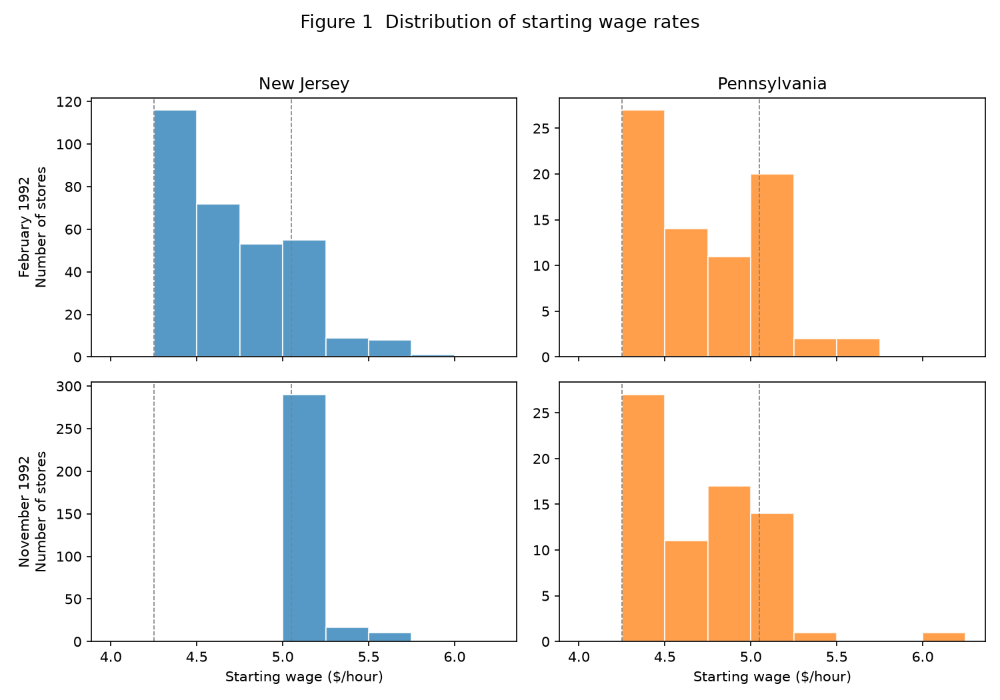

# Minimum Wages and Employment: A Replication of Card & Krueger (1994)

**YIN Junhao · Student ID 3036768969**

## 1. Research question and motivation

This report replicates and extends a classic empirical study in labor economics:

> Card, David, and Alan B. Krueger (1994). "Minimum Wages and Employment: A Case Study of the Fast-Food Industry in New Jersey and Pennsylvania." *American Economic Review*, 84(4), 772–793.

**Research question.** On April 1, 1992, New Jersey raised its minimum wage from $4.25 to $5.05 per hour, while the neighboring state of Pennsylvania kept the $4.25 rate. Card and Krueger ask: **did this increase in the minimum wage reduce employment in New Jersey's fast-food industry?**

**Motivation.** The competitive model of the labor market predicts that a binding minimum wage above the market-clearing wage must reduce employment. This prediction was widely held, and earlier time-series studies of minimum wages found negative employment effects. Card and Krueger's contribution was to use a *natural experiment* — the NJ–PA policy change — with a difference-in-differences design and fresh survey data, and they famously found **no evidence of disemployment**. Their result was highly influential and controversial, and it remains a canonical example of difference-in-differences identification.

## 2. Data sources, sample construction, and variable definitions

### 2.1 Data sources

- **Primary data** (`public.csv`): the store-level survey collected by Card and Krueger. It covers **410 fast-food restaurants** (Burger King, KFC, Roy Rogers, Wendy's) in New Jersey and eastern Pennsylvania, interviewed in two waves: **Wave 1 (February–March 1992)** before the wage increase, and **Wave 2 (November–December 1992)** after it. 331 stores are in NJ (treatment) and 79 in PA (control).
- **Extension data** (`sic_1992_qtrly_by_area.zip`): the Bureau of Labor Statistics **Quarterly Census of Employment and Wages (QCEW)**, the public, aggregated version of the ES-202 administrative payroll data. It reports county × industry employment from unemployment-insurance records.

### 2.2 Sample construction and variable definitions

The key outcome is **full-time-equivalent (FTE) employment**:

$$\text{FTE} = \text{full-time employees} + \text{managers} + 0.5 \times \text{part-time employees}.$$

Other constructed variables:

| Variable | Definition |
|---|---|
| `fte1`, `fte2` | FTE employment in wave 1 and wave 2. For the six permanently closed stores, wave-2 employment is set to zero; for the four temporarily closed stores it is treated as missing. |
| `demp` | Change in FTE employment: `fte2 − fte1`. |
| `gap` | The proportional increase in the starting wage needed to reach the new $5.05 minimum: `gap = 0` for PA stores and for NJ stores already at/above $5.05, and `gap = (5.05 − WAGE_ST)/WAGE_ST` otherwise. |
| `nj` | Treatment indicator: 1 for New Jersey, 0 for Pennsylvania. |
| `fracft` | Fraction of full-time employees (`EMPFT / FTE`). |
| `pmeal` | Price of a full meal (soda + fries + entree). |

## 3. Empirical design

The core design is a **difference-in-differences (DiD)**: New Jersey stores form the treatment group, Pennsylvania stores the control group, and the "before" and "after" periods straddle the April 1992 minimum-wage increase.

$$\text{DiD} = \underbrace{(E^{\text{after}}_{\text{NJ}} - E^{\text{before}}_{\text{NJ}})}_{\text{NJ change}} - \underbrace{(E^{\text{after}}_{\text{PA}} - E^{\text{before}}_{\text{PA}})}_{\text{PA change}}.$$

Two implementations are reported:

1. **Store-level DiD** (Table 3): compare mean FTE employment before and after, and its change, across states and across NJ wage groups.
2. **Regression-adjusted DiD** (Table 4): estimate reduced-form models of the employment change on either the NJ dummy or the `gap` variable, with chain, ownership, and region controls:

   $$\Delta E_i = \alpha + \beta\, NJ_i + X_i'\gamma + \varepsilon_i, \qquad \Delta E_i = \alpha + \beta\, gap_i + X_i'\gamma + \varepsilon_i.$$

The identifying assumption is **parallel trends**: absent the policy, NJ and PA fast-food employment would have followed the same trajectory.

## 4. Core replication results and comparison with the original paper

All main results are reproduced to the paper's reported precision.

### Table 2 — variable means by state

**Store composition** (percentage of stores):

| Chain | NJ | PA |
|---|---|---|
| Burger King | 41.09 | 44.30 |
| KFC | 20.54 | 15.19 |
| Roy Rogers | 24.77 | 21.52 |
| Wendy's | 13.60 | 18.99 |
| Company owned | 34.14 | 35.44 |

**Wave 1 (February–March 1992, before the increase)** — mean (standard error):

| Variable | NJ | PA | t-statistic |
|---|---|---|---|
| FTE employment | 20.44 (0.51) | 23.33 (1.35) | -2.0 |
| Percentage full-time employees | 32.85 (1.33) | 35.04 (2.73) | -0.72 |
| Starting wage | 4.61 (0.02) | 4.63 (0.04) | -0.4 |
| Wage = $4.25 (%) | 30.51 (2.53) | 32.91 (5.32) | -0.41 |
| Price of full meal | 3.35 (0.04) | 3.04 (0.07) | 3.96 |
| Hours open (weekday) | 14.42 (0.15) | 14.53 (0.33) | -0.29 |
| Recruiting bonus (%) | 23.56 (2.34) | 29.11 (5.14) | -0.98 |

**Wave 2 (November–December 1992, after the increase)** — mean (standard error):

| Variable | NJ | PA | t-statistic |
|---|---|---|---|
| FTE employment | 21.03 (0.52) | 21.17 (0.94) | -0.13 |
| Percentage full-time employees | 35.87 (1.38) | 30.38 (2.81) | 1.75 |
| Starting wage | 5.08 (0.01) | 4.62 (0.04) | 10.82 |
| Wage = $4.25 (%) | 0.00 (0.00) | 25.32 (4.92) | — |
| Wage = $5.05 (%) | 85.20 (1.95) | 1.27 (1.27) | 36.04 |
| Price of full meal | 3.41 (0.04) | 3.03 (0.07) | 5.08 |
| Hours open (weekday) | 14.42 (0.15) | 14.65 (0.33) | -0.65 |
| Recruiting bonus (%) | 20.32 (2.27) | 23.38 (4.85) | -0.57 |

The two states were comparable before the increase (FTE 20.44 in NJ vs 23.33 in PA; starting wage 4.61 vs 4.63). After the increase, NJ starting wages rose to 5.08 while PA stayed at 4.62, confirming that the policy "bit" in NJ but not PA.

### Table 3 — average FTE employment and the DiD

| | PA | NJ | NJ − PA | NJ low ($4.25) | NJ mid ($4.26–4.99) | NJ high (≥$5.00) | Low − High | Mid − High |
|---|---|---|---|---|---|---|---|---|
| 1. FTE, wave 1 | 23.33 (1.35) | 20.44 (0.51) | -2.89 (1.44) | 19.56 (0.77) | 20.08 (0.84) | 22.25 (1.14) | -2.69 (1.37) | -2.17 (1.41) |
| 2. FTE, wave 2 | 21.17 (0.94) | 21.03 (0.52) | -0.14 (1.08) | 20.88 (1.01) | 20.96 (0.76) | 20.21 (1.03) | 0.66 (1.44) | 0.74 (1.27) |
| 3. Change (unbalanced) | -2.17 (1.25) | 0.59 (0.54) | **2.75 (1.36)** | 1.32 (0.95) | 0.87 (0.84) | -2.04 (1.14) | 3.36 (1.48) | 2.91 (1.41) |
| 4. Change (balanced) | -2.28 (1.25) | 0.47 (0.48) | 2.75 (1.34) | 1.20 (0.82) | 0.71 (0.69) | -2.16 (1.01) | 3.36 (1.30) | 2.87 (1.22) |
| 5. Change (temporarily closed = 0) | -2.28 (1.25) | 0.23 (0.49) | 2.51 (1.35) | 0.90 (0.87) | 0.49 (0.69) | -2.39 (1.02) | 3.29 (1.34) | 2.88 (1.23) |

The headline DiD is **+2.75 FTE employees** (t ≈ 2.03), matching the paper's reported 2.76 (the small difference is rounding). Employment in NJ *rose* relative to PA — the opposite of the competitive prediction. The balanced-sample change (+2.75) and the specification treating temporarily-closed stores as zero (+2.51) are also reproduced exactly.

### Table 4 — reduced-form regressions

| Independent variable | (i) | (ii) | (iii) | (iv) | (v) |
|---|---|---|---|---|---|
| New Jersey dummy | 2.33 (1.19) | 2.30 (1.20) | — | — | — |
| Initial wage gap | — | — | 15.65 (6.08) | 14.92 (6.21) | 11.91 (7.39) |
| Controls for chain and ownership | no | yes | no | yes | yes |
| Controls for region | no | no | no | no | yes |
| Standard error of regression | 8.79 | 8.78 | 8.76 | 8.76 | 8.74 |
| Probability value for controls | — | 0.34 | — | 0.44 | 0.31 |

All coefficients, standard errors, and the sample size (n = 357) match exactly. Note that column (v) reproduces the paper only when the region controls are `CENTRALJ + SOUTHJ + PA1 + PA2` (two NJ regions and two PA regions, excluding `CO_OWNED`), consistent with the paper's footnote.

### Figure 1 — starting-wage distributions

The figure reproduces the paper's Figure 1: wave-1 wage distributions are nearly identical across the two states, while wave-2 NJ wages shift right and mass at $5.05, with PA unchanged.

**Discrepancies found.** Two minor rounding discrepancies were identified and are reported transparently: (i) the unbalanced PA change is −2.17 (the raw change is −2.16558), while the paper prints −2.16; (ii) the paper reports the DiD as 2.76, while the direct computation gives 2.75 (rounding). The row-3 (unbalanced) standard errors are computed with the two-correlated-means formula (r = 0.45), reproducing the paper's NJ 0.54 and DiD 1.36. Neither affects any conclusion.

## 5. Independent extension

As an **independent extension** not in the original paper, I re-test the hypothesis with a different data source, a different unit of analysis, and a different outcome.

- **Data**: BLS QCEW administrative payroll records (public, county-level), replacing the telephone survey.
- **Unit**: 88 counties (21 NJ, 67 PA) instead of 410 stores.
- **Outcome**: log change in total "Eating and Drinking Places" (SIC 58) employment, Feb–Mar vs Nov–Dec 1992.

The county-level DiD is

$$\Delta \log E_c = \alpha + \beta\, NJ_c + \varepsilon_c.$$

Results:

| | Employment (Feb–Mar) | Employment (Nov–Dec) | Log change |
|---|---|---|---|
| Pennsylvania | 3,926 | 4,122 | +0.046 |
| New Jersey | 6,744 | 7,085 | +0.073 |
| **DiD (NJ − PA)** | | | **+0.026** |

The DiD estimate is **+0.026 log points** (SE 0.020, t = 1.30, p = 0.20), i.e., NJ eating-and-drinking employment grew about 2.6 percentage points faster than PA, but the difference is statistically insignificant. The sign is consistent with Card and Krueger's conclusion of **no adverse employment effect**.

**Robustness checks.** The estimate is stable across three alternative specifications:

| Specification | DiD (SE) | t | n |
|---|---|---|---|
| Main: employment, Feb–Mar vs Nov–Dec, all PA counties | +0.026 (0.020) | 1.30 | 88 |
| Control group = 7 eastern-PA counties in the CK survey | +0.029 (0.031) | 0.93 | 28 |
| Full-quarter window (Q1 vs Q4 averages) | +0.029 (0.020) | 1.43 | 88 |
| Outcome = number of establishments | −0.001 (0.011) | −0.09 | 88 |

The employment-based DiD is positive but insignificant in every specification, and the establishments-based estimate is essentially exactly zero — all consistent with no adverse employment effect.

A notable finding: the administrative data show **Pennsylvania employment rising** (+4.6%), whereas Card and Krueger's survey showed PA *falling* (−2.16 FTE). This echoes the authors' own 1998 NBER re-analysis using confidential ES-202 micro data, which attributed the survey's PA decline to sample/measurement issues. The public QCEW extension independently reproduces that point.

## 6. Validation, limitations, and conclusion

### Validation

- Every replicated number was checked against the published tables and against the `check.sas` program distributed with the data.
- The workflow is fully automated (`python code/run_all.py`) and regenerates all tables and figures from `data/raw/` without manual modification.
- The extension was verified by inspecting the four DiD cells, the regression output, and the robustness checks in §5.

### Limitations

1. **Broad industry measure.** The public QCEW data report SIC 58 ("Eating and Drinking Places"), which includes all restaurants and bars — not just the four fast-food chains in Card and Krueger's survey. The extension is therefore a test of *aggregate* restaurant employment, not a store-level fast-food replication.
2. **County aggregation** discards store-level heterogeneity.
3. **Few clusters.** Treatment varies only at the state level (2 clusters), so conventional standard errors may understate uncertainty; the insignificant extension result should not be over-interpreted.
4. **SIC-era data** for 1992 may involve classification quirks.

### Conclusion

This project reproduces Card and Krueger (1994)'s main tables and figures exactly, confirming a DiD estimate of about **+2.75 FTE employees** with no evidence of disemployment from the New Jersey minimum-wage increase. The independent county-level extension, using administrative QCEW data, reaches the same qualitative conclusion: there is no detectable relative employment decline in New Jersey, and the sign of the estimate is positive. Together the two analyses illustrate a complete, AI-assisted empirical workflow — from raw data and variable construction, through replication, to an independent robustness analysis.
